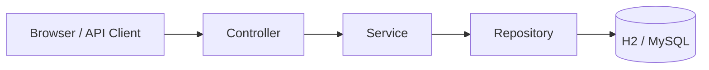
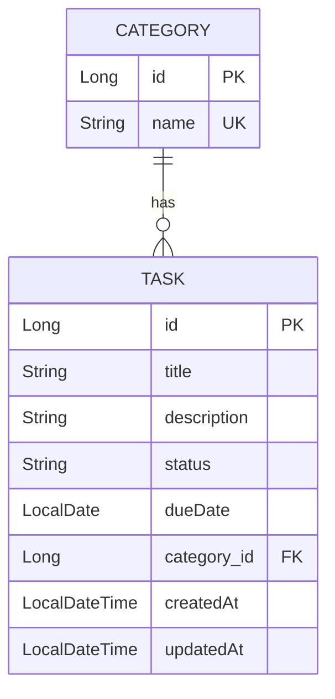

# Task Manager API

[](https://openjdk.org/projects/jdk/17/)
[](https://spring.io/projects/spring-boot)
[](https://maven.apache.org/)
[](#database-configuration)
[](LICENSE)

A RESTful task management application built with **Spring Boot**, **Spring Data JPA (Hibernate)** and **Lombok**, with a lightweight web interface served directly by the application.

The project follows a clean layered architecture (controller, service, repository) with DTO-based request/response models, bean validation and centralized exception handling.

<!-- Add a screenshot of the web UI here:

-->

---

## Table of Contents

- [Features](#features)
- [Tech Stack](#tech-stack)
- [Architecture](#architecture)
- [Data Model](#data-model)
- [Getting Started](#getting-started)
- [Database Configuration](#database-configuration)
- [API Reference](#api-reference)
- [Validation and Error Handling](#validation-and-error-handling)
- [Web Interface](#web-interface)
- [Project Structure](#project-structure)
- [Roadmap](#roadmap)
- [Author](#author)
- [License](#license)

---

## Features

- Full CRUD operations for tasks
- Task categorization with a many-to-one relationship
- Filter tasks by status (`TODO`, `IN_PROGRESS`, `DONE`)
- DTO pattern to keep the API contract separate from persistence entities
- Bean Validation on all incoming requests
- Centralized exception handling with consistent JSON error responses
- Automatic audit timestamps (`createdAt`, `updatedAt`) managed by Hibernate
- Zero-setup development database (H2) with an optional MySQL profile
- Sample data seeded on first startup
- Lightweight web UI built with HTML, CSS and vanilla JavaScript

## Tech Stack

| Layer          | Technology                                   |
|----------------|----------------------------------------------|
| Language       | Java 17                                      |
| Framework      | Spring Boot 3 (Web, Data JPA, Validation)    |
| Persistence    | Hibernate / JPA                              |
| Database       | H2 (default), MySQL (optional profile)       |
| Boilerplate    | Lombok                                       |
| Build tool     | Maven                                        |
| Frontend       | HTML5, CSS3, JavaScript (no build step)      |

## Architecture

The application is organized in layers, each with a single responsibility.



| Layer          | Responsibility                                                          |
|----------------|-------------------------------------------------------------------------|
| **Controller** | Exposes REST endpoints, validates input, returns HTTP responses         |
| **Service**    | Contains business rules and transaction boundaries                      |
| **Repository** | Data access through Spring Data JPA                                     |
| **Entity**     | JPA models mapped to database tables                                    |
| **DTO**        | Request and response objects exposed through the API                    |
| **Exception**  | Custom exceptions and a global `@RestControllerAdvice` handler          |

## Data Model



**Business rules**

- A task's status defaults to `TODO` when it is not provided.
- Category names are unique (case-insensitive).
- A category that still has tasks cannot be deleted.

## Getting Started

### Prerequisites

- Java 17 or higher
- Maven 3.6+ (or use your IDE's built-in Maven support)

### Run locally

```bash
git clone https://github.com/<your-username>/task-manager-api.git
cd task-manager-api
mvn spring-boot:run
```

Once started:

| Resource       | URL                                  |
|----------------|--------------------------------------|
| Web UI         | http://localhost:8080                |
| REST API       | http://localhost:8080/api            |
| H2 Console     | http://localhost:8080/h2-console     |

For the H2 console use JDBC URL `jdbc:h2:mem:taskdb`, username `sa` and an empty password.

### Build and run the JAR

```bash
mvn clean package
java -jar target/task-manager-api-1.0.0.jar
```

### Run tests

```bash
mvn test
```

## Database Configuration

By default the application uses an **in-memory H2 database**, so no setup is required. Data is reset on every restart, and sample data is loaded automatically.

To use **MySQL**:

1. Make sure a MySQL server is running locally.
2. Update the credentials in `src/main/resources/application-mysql.properties`.
3. Start the application with the `mysql` profile:

```bash
mvn spring-boot:run -Dspring-boot.run.profiles=mysql
```

The `taskdb` database is created automatically if it does not exist, and the schema is managed by Hibernate (`ddl-auto=update`).

> Do not commit real database credentials. Keep them in a local, untracked properties file or use environment variables.

## API Reference

Base URL: `http://localhost:8080/api`

### Tasks

| Method   | Endpoint                  | Description                  | Success |
|----------|---------------------------|------------------------------|---------|
| `POST`   | `/tasks`                  | Create a task                | `201`   |
| `GET`    | `/tasks`                  | List all tasks               | `200`   |
| `GET`    | `/tasks?status={status}`  | List tasks by status         | `200`   |
| `GET`    | `/tasks/{id}`             | Get a task by id             | `200`   |
| `PUT`    | `/tasks/{id}`             | Update a task                | `200`   |
| `DELETE` | `/tasks/{id}`             | Delete a task                | `204`   |

### Categories

| Method   | Endpoint            | Description                                  | Success |
|----------|---------------------|----------------------------------------------|---------|
| `POST`   | `/categories`       | Create a category                            | `201`   |
| `GET`    | `/categories`       | List all categories                          | `200`   |
| `DELETE` | `/categories/{id}`  | Delete a category (only if it has no tasks)  | `204`   |

### Example: create a task

**Request**

```http
POST /api/tasks
Content-Type: application/json
```

```json
{
  "title": "Write unit tests",
  "description": "Add tests for TaskService",
  "status": "TODO",
  "dueDate": "2030-01-31",
  "categoryId": 1
}
```

**Response** `201 Created`

```json
{
  "id": 4,
  "title": "Write unit tests",
  "description": "Add tests for TaskService",
  "status": "TODO",
  "dueDate": "2030-01-31",
  "categoryId": 1,
  "categoryName": "Study",
  "createdAt": "2026-11-17T10:30:00.123",
  "updatedAt": "2026-11-17T10:30:00.123"
}
```

### Example: cURL

```bash
# List tasks that are in progress
curl "http://localhost:8080/api/tasks?status=IN_PROGRESS"

# Create a category
curl -X POST http://localhost:8080/api/categories \
  -H "Content-Type: application/json" \
  -d '{"name": "Work"}'
```

## Validation and Error Handling

### Validation rules

| Field         | Rule                                  |
|---------------|---------------------------------------|
| `title`       | Required, maximum 100 characters      |
| `description` | Optional, maximum 500 characters      |
| `status`      | Optional (`TODO`, `IN_PROGRESS`, `DONE`) |
| `dueDate`     | Optional, ISO format (`yyyy-MM-dd`)   |
| `categoryId`  | Optional, must reference an existing category |
| Category `name` | Required, maximum 50 characters, unique |

### Error responses

All errors are returned in a consistent JSON structure.

```json
{
  "timestamp": "2026-11-17T10:31:00.456",
  "status": 400,
  "error": "Bad Request",
  "message": "Validation failed",
  "details": {
    "title": "Title is required"
  }
}
```

| Status | Meaning                                                              |
|--------|----------------------------------------------------------------------|
| `400`  | Validation failed, malformed JSON or invalid enum value              |
| `404`  | Task or category not found                                           |
| `409`  | Conflict, such as a duplicate category name or deleting a category that still has tasks |

## Web Interface

A lightweight single-page interface is served from `src/main/resources/static` and is available at `http://localhost:8080`. It communicates with the REST API using the `fetch` API and requires no build step.

From the UI you can create tasks, filter them by status, update a task's status, delete tasks and manage categories.

## Project Structure

```
task-manager-api
├── pom.xml
├── README.md
└── src
    ├── main
    │   ├── java/com/example/taskmanager
    │   │   ├── TaskManagerApplication.java
    │   │   ├── config          # Sample data loader
    │   │   ├── controller      # REST controllers
    │   │   ├── dto             # Request / response models
    │   │   ├── entity          # JPA entities and enums
    │   │   ├── exception       # Custom exceptions and global handler
    │   │   ├── repository      # Spring Data JPA repositories
    │   │   └── service         # Business logic
    │   └── resources
    │       ├── application.properties
    │       ├── application-mysql.properties
    │       └── static          # Web UI (index.html, style.css, app.js)
    └── test
        └── java/com/example/taskmanager
```

## Roadmap

- [ ] Unit and integration tests for the service and controller layers
- [ ] Pagination and sorting for task listings
- [ ] API documentation with Swagger / OpenAPI
- [ ] Authentication and authorization with Spring Security and JWT
- [ ] Containerization with Docker and Docker Compose
- [ ] Separate React frontend consuming the API

## Author

**Md Faijan Ali**

- GitHub: [github.com/<your-username>](https://github.com/<your-username>)
- LinkedIn: [linkedin.com/in/<your-profile>](https://www.linkedin.com/in/<your-profile>)

## License

This project is licensed under the MIT License. See the [LICENSE](LICENSE) file for details.